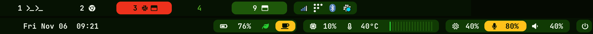
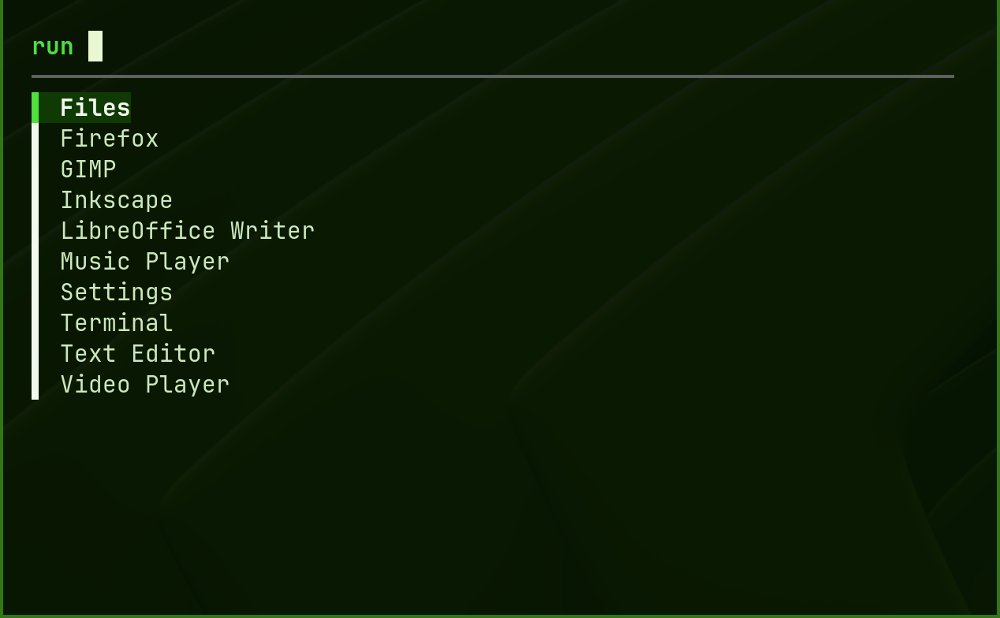

# Bricolage

A minimal, hand-assembled desktop environment on sway, as a home-manager module: the bar, a launcher
and power menu, the lock screen and idle policy, notifications and tray applets. It is an opinionated
stack for a uniform, familiar environment across machines. It has no theme of its own: any palette
can drive it (see Colors).

| Part | What |
|---|---|
| sway | the session: keys, input, window rules, title bars |
| waybar | the bar: workspaces, tray, task sources, energy, load and control widgets, the power menu |
| menu | fzf in a small floating foot window: the launcher (`$mod+d`) and the power menu (`$mod+Shift+p`) |
| gtklock, swayidle | the lock screen, with a blurred wallpaper; lock, then screen off, then suspend on battery |
| mako, swaynag | notifications and banners |
| nm-applet, blueman | network and Bluetooth in the tray |
| polkit agent | the password dialog for polkit-gated actions |
| btop, htop | system monitors, opened from the CPU and memory widgets (click again to close) |
| ranger | the file manager, with sixel image previews in foot |

## A tour

### The bar

<p align="center">
  
</p>

The colors carry meaning, so the bar can be scanned for what is off:

| Color | Meaning | Example |
|---|---|---|
| green | at rest | everything in the picture except the amber and scarlet |
| amber fill | a toggle you flipped; click to clear it | keep-awake on, live mic, muted speaker |
| amber text or glyph | a variance, asking nothing | performance power profile, memory at 80% |
| scarlet fill | needs attention now | an urgent workspace, critical battery or temperature (these flash) |
| scarlet text | a serious variance | memory at 90% |

Clicks: the CPU and memory widgets open btop (left) or htop (right) in a floating window, and a second
click closes it. Volume and microphone toggle mute (right-click opens the mixer), keep-awake toggles
idle locking, the battery switches between percent and time, and the power button opens the power menu.

### Launcher and power menu

<p align="center">
  
</p>

`$mod+d` opens the launcher: type to filter the applications, Enter to run, or type any command.
`$mod+Shift+p` opens the power menu (lock, suspend, log out, reboot, power off) in the same window.

### Keys

Bricolage keeps sway's usual keys and adds these:

| Key | Action |
|---|---|
| `$mod+d` | the launcher |
| `$mod+Shift+p` | the power menu |
| `$mod+Ctrl+l` | lock the screen |
| `Print` | select a region and copy it as an image |
| volume, mute, mic mute, brightness keys | work while locked |
| Caps Lock | acts as Escape (Shift+Caps Lock is the real one) |

The lid and the displays have their own rules: see `docs/clamshell.md`.

## Use

```nix
{
  imports = [ bricolage.homeModules.default ];
  bricolage.enable = true;
  bricolage.wallpaper = "/usr/share/backgrounds/wallpaper.jpg";
}
```

Without flakes, import `modules/`. Run `host-probe.sh` inside the session on a new machine to find its
temperature sensor.

## Colors

`bricolage.colors` is the set of colors Bricolage draws with, as `#rrggbb` strings. Without it, a
neutral dark palette is used. These names are required: `bg`, `surface`, `surface_subtle`,
`selection`, `border`, `fg_faint`, `fg_subtle`, `fg_muted`, `fg`, `error`, `warning`, `success`,
`accent`, `special`, `string`. Extra names are passed to the stylesheets.

Bricolage colors its own parts from these, and sway's window colors unless your theme sets them.
The rest it leaves to your theme (see Coverage).

```nix
# Malachite: its roles already use these names
bricolage.colors = config.malachite.colorscheme.roles;
bricolage.btop.colorTheme = "malachite-emerald";

# Any other palette: name its colors yourself
bricolage.colors = { bg = "#1e1e2e"; surface = "#313244"; /* ... */ accent = "#89b4fa"; };

# Any Base16 scheme
bricolage.colors = bricolage.lib.fromBase16 { base00 = "2e3440"; /* ... base0F */ };
```

## Coverage

Who colors what:

| Part | Colored by | With no theme support |
|---|---|---|
| waybar, gtklock, swaynag | Bricolage, from `bricolage.colors` | always themed |
| sway window colors | your theme module, else Bricolage from `bricolage.colors` | always themed |
| mako | your theme module | mako's stock colors |
| foot colors | your theme module | foot's stock colors |
| menu (fzf) | your theme's `FZF_DEFAULT_OPTS` | fzf's stock colors |
| btop | your theme module, or a theme named in `bricolage.btop.colorTheme` | btop's own default |
| htop | the escape-sequence file in `bricolage.htop.colorsFile` | the terminal's colors |
| ranger | the terminal's colors (your theme's foot port) | the terminal's colors |

Sway's window colors aside, Bricolage never substitutes colors for a program your theme does not
cover: that program is stock, with no error. Malachite covers all of them. For another theme, check which of the programs above it
themes.

### If your theme lacks a port

A stock program is not wrong, only unthemed. To fill a gap, theme that program in your own config,
for example `services.mako.settings`; it takes effect because Bricolage does not set it. A gap many people share is better fixed as a port in the
theme.

## Options

| Option | Meaning |
|---|---|
| `bricolage.enable` | apply Bricolage; without it importing the module changes nothing |
| `bricolage.colors` | the colors above |
| `bricolage.btop.colorTheme` | a btop theme to select, when the theme module doesn't set btop's |
| `bricolage.htop.colorsFile` | a file of terminal color escape sequences for the htop window |
| `bricolage.wallpaper` | the image sway paints and gtklock blurs; null for the `bg` color |
| `bricolage.laptop` | the machine has a battery and backlight; defaults the widgets and suspend below |
| `bricolage.idle.suspendOnBattery` | suspend after a long idle on battery |
| `bricolage.clamshell.enable` | the internal panel is off while the lid is closed and another display is active ([docs/clamshell.md](docs/clamshell.md)); works with or without a layout tool |
| `bricolage.bar.workspaces.{pinned,buttonMinWidth}` | always-shown workspaces and the button width |
| `bricolage.bar.widgets.<name>` | one switch per widget; `temperature` is the sensor's hwmon path or null |
| `bricolage.bar.tasks.<name>.{enable,command,onClick,format}` | a source of tasks (agent sessions, builds, a pane's bell): a command that prints waybar JSON whose `class` is `none`, `idle`, `running`, `waiting` or `down`; one pill, left of the other widgets. `format` is a waybar format string for it (`{text}` is what the command reports), for the same glyphs and right-aligned fields as the other widgets |
| `bricolage.bar.agents.{enable,watchCommand,listCommand}` | the agent-sessions widget, a task source named `agents`: it formats a view of the sessions ([docs/agents.md](docs/agents.md)) from the two commands, and a click raises the window of the session that most needs you |
| `bricolage.polkitAgent` | the path of the distro's polkit agent (it differs between distros) |
| `bricolage.terminal.shell` | the shell foot starts; null for the login shell |
| `bricolage.terminal.opacity` | the terminal's background opacity, 0 to 1 (default 1.0) |

## Requires (outside Nix)

Bricolage runs on any Linux system with Nix and home-manager; it doesn't need NixOS. From the
distro: sway and gtklock (the lock screen authenticates through the system's PAM stack), plus
`bubblewrap`, `xdg-desktop-portal` with its gtk and wlr backends, `power-profiles-daemon`,
NetworkManager, `blueman` and the polkit-gnome agent (set `bricolage.polkitAgent` to its path, which
varies by distro). Package names vary too. systemd and procps are assumed.

## License

MIT.
