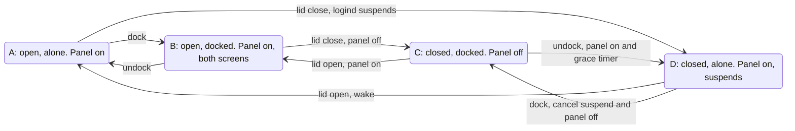

# Clamshell

What is on when the lid opens and closes and a display is attached or removed, and when the machine
sleeps. The state is derived from two inputs, the lid and the set of enabled external outputs, so
there are four states.

## Transitions

| From | To | Event | Action |
|---|---|---|---|
| A | B | dock | none |
| B | A | undock | none |
| B | C | lid close | disable the panel |
| C | B | lid open | enable the panel, whatever the layout |
| A | D | lid close | suspend (logind's default) |
| D | A | lid open | none; the machine wakes |
| C | D | undock, last display | enable the panel; suspend after the grace delay |
| D | C | dock, within the grace delay | cancel the suspend; disable the panel |

## Rules

- Docked means at least one enabled external output. An output blanked by the idle timer counts; a
  disabled one does not.
- Outside a lid-open event the panel is enabled only when it would be the last display, so a layout
  may keep it off with the lid open; opening the lid always turns it on.
- Invariant: at least one display is enabled. The panel stays on in
  D because it is the only output.
- The state is recomputed from the lid and the outputs on every event; nothing is stored except the
  grace timer. Resume from suspend is another recompute.
- Triggers: the lid switch, sway `output` events, and resume. Unplugging the last display with the lid
  shut fires no lid event, so the output events are required.
- The policy does not depend on a layout tool. It works with kanshi, a hand-written layout, a widget,
  or none.

## Lock and logind

- Lid close locks only in D (the panel is the last display); docked, the idle timer locks. The panel
  is not disabled while a lock is up, since gtklock crashes when its output goes away; the policy
  retries until the lock is gone.
- The grace-timer suspend (C to D) locks the session and waits for the locker before suspending, so
  the panel does not wake showing the session.
- While another display is active the policy holds a `handle-lid-switch` inhibitor, so logind does
  not suspend on a closed lid even when its `HandleLidSwitchDocked` is `suspend`. In D the inhibitor
  is released and logind's own lid action applies.

## Sleep

Two independent mechanisms; neither is tied to the lock timer.

- **Idle timeout.** The same in every state. Suspends only on battery, and only when the user has not
  held it off from the bar. The lock and screen-off timers are separate.
- **Lid action.** Only entering D suspends, on any power source. The grace delay keeps a link retrain
  or a monitor's deep standby from suspending the machine.

## Not covered

- Turning the panel off while it is the only output, or keeping it on under a closed lid.
- Convertible hinge modes, which are a separate event from the lid switch.
